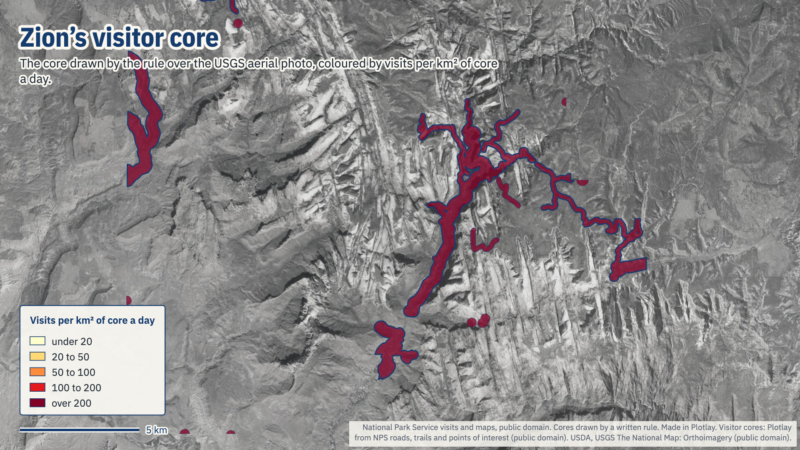
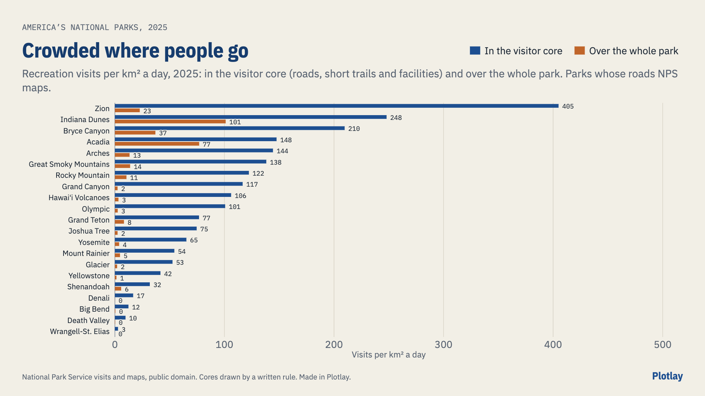

# Where are America's national parks really crowded?

The 20 most visited National Parks of 2025 and five contrasts, month by month since 2015: recreation visits per km² a day over the whole park, and in its **visitor core**, the developed corridor along the scenic roads, short trails and facilities where most visitors spend their day. **Live version, with an interactive map:** [getplotlay.com/showcase/us-parks-crowding](https://www.getplotlay.com/showcase/us-parks-crowding/)



Spread over the whole park, Zion's 4,984,525 visits in 2025 come to **22.7 a km² a day**. But Zion's visitor core is 33.72 km², 5.6% of the park, and there it is **405 a km² a day**, 564 in May 2025. Of the parks whose roads the National Park Service maps, Zion has the busiest core, ahead of Indiana Dunes, Bryce Canyon and Acadia.

NPS counts visits per park, per month, with no idea of where in the park people go. Its boundaries say how big a park is, not where the crowds are. [Plotlay](https://www.getplotlay.com) put both on one map: each park and its core keyed by the NPS unit code, the core drawn by one written rule from NPS roads, trails and facilities over the USGS aerial photo, and each month on a slider.

[](https://app.plotlay.io/?example=us-parks-crowding&as=client)

## What the data says

- **The core is where the crowd is.** The median core is 8.6% of its park. Wrangell-St. Elias's is 0.19% (103 of 53,337 km²), Denali's 0.36%, Grand Canyon's 2.14%.
- **The ranking changes.** By core density Grand Canyon moves from 14th to 8th and Zion from 4th to first; Shenandoah falls from 9th to 17th (Spearman 0.88 between the two rankings, the 21 parks with NPS roads).
- **The seasons swing hard.** In the average month of 2015 to 2024, Yellowstone's core takes 97 visits a km² a day in Jul and 2 in Nov; Acadia's 320 in Aug and 6 in Jan. Zion never empties: 108 in Jan.
- **The top 20 take most of the visits:** 71,168,919 of the 93,892,121 recreation visits to all 63 National Parks in 2025.

| Park | Park, km² | Core, km² (share) | Visits, 2025 | A day per km² of park | A day per km² of core |
|---|---|---|---|---|---|
| Zion | 602 | 33.7 (5.6%) | 4,984,525 | 22.7 | 405 |
| Indiana Dunes | 71 | 29.1 (40.8%) | 2,629,497 | 101.1 | 248 |
| Bryce Canyon | 146 | 25.7 (17.6%) | 1,967,367 | 37.0 | 210 |
| Acadia | 145 | 75.7 (52.1%) | 4,079,318 | 76.9 | 148 |
| Arches | 309 | 28.7 (9.3%) | 1,511,740 | 13.4 | 144 |
| Great Smoky Mountains | 2,262 | 228.5 (10.1%) | 11,527,939 | 14.0 | 138 |
| Rocky Mountain | 1,081 | 93.5 (8.7%) | 4,171,431 | 10.6 | 122 |
| Grand Canyon | 4,869 | 104.1 (2.1%) | 4,430,653 | 2.5 | 117 |
| Hawaiʻi Volcanoes | 1,557 | 48.5 (3.1%) | 1,877,854 | 3.3 | 106 |
| Olympic | 3,717 | 97.5 (2.6%) | 3,584,187 | 2.6 | 101 |
| Grand Teton | 1,255 | 135.6 (10.8%) | 3,800,648 | 8.3 | 77 |
| Joshua Tree | 3,227 | 107.5 (3.3%) | 2,932,644 | 2.5 | 75 |
| Yosemite | 3,026 | 179.6 (5.9%) | 4,278,413 | 3.9 | 65 |
| Mount Rainier | 957 | 82.6 (8.6%) | 1,635,342 | 4.7 | 54 |
| Glacier | 4,080 | 163.3 (4.0%) | 3,136,557 | 2.1 | 53 |
| Yellowstone | 8,901 | 313.8 (3.5%) | 4,762,988 | 1.5 | 42 |
| Shenandoah | 799 | 144.5 (18.1%) | 1,682,152 | 5.8 | 32 |
| Denali | 24,389 | 89.0 (0.4%) | 543,300 | 0.1 | 17 |
| Big Bend | 3,282 | 126.0 (3.8%) | 568,104 | 0.5 | 12 |
| Death Valley | 13,901 | 373.5 (2.7%) | 1,320,134 | 0.3 | 10 |
| Wrangell-St. Elias | 53,337 | 103.1 (0.2%) | 108,840 | 0.0 | 3 |

The four parks with no NPS road data (Cuyahoga Valley, Hot Springs, Gateway Arch, New River Gorge) are in the data but left out of the table and the rankings: their cores follow every public street (Census TIGER), so they read larger and emptier than an NPS-mapped core would.



### The visitor core rule

One rule for every park, measured in equal-area projections (EPSG:5070 for the lower 48, EPSG:3338 for Alaska, a local equal-area projection for Hawaiʻi): the union of 250 m either side of the paved park roads (NPS classes Primary, Secondary and Local, plus paved Service and Unknown roads), 100 m either side of trails within 2 km of those roads, a 200 m disc round each visitor facility (visitor centres, lodging, campgrounds, trailheads, overlooks, parking and the like) and each NPS parking lot grown by 50 m, clipped to the park. With 500 m road buffers the five busiest cores are the same parks in the same order.

### Read it carefully

- **Counting methods vary by park.** NPS counts visits with traffic counters and per-vehicle multipliers, set in each park's own counting instructions and changed over the years. A jump from one year to the next can be a new method, not a crowd.
- **The cores are drawn estimates**, from one written rule applied to NPS's mapped roads, trails and facilities, not measured visitor footprints. NPS's road classes are used differently from park to park. Denali's core counts its whole park road, though private cars stop at mile 15.
- **Visits are not unique people.** A person who leaves and comes back counts again; a week's stay counts once.
- **Closures show.** April 2020 had zero visits in 9 of these parks; Death Valley closed after the floods of September 2023; the federal shutdown of 1 October to 12 November 2025 shows in October 2025, and October and November 2025 may still change.
- **Visits per km² a day** is a month's visits over the area and the days in that month, so months of 28 and 31 days compare. A busy day can be several times the average.

## How it was made with Plotlay

1. **A map project** on the USGS National Map aerial photo (public domain), and two **Data layers**.
2. **Parks: Take all** from the NPS boundary file: 25 parks in one step, keyed by unit code.
3. **Cores: Take all** from the cores file (the rule above), keyed the same way.
4. **Link by key** each park's 2025 summary, then 3,300 park months (January 2015 to December 2025) as a **time axis**.
5. **Colour** the cores by visits per km² of core a day and the parks, lighter, by visits per km² of park, for the month on the slider.
6. **Charts and map pictures** in the Analysis workspace; **export** GeoJSON, TopoJSON, CSV with WKT and the linked data. Nothing here comes from OpenStreetMap.

## What's here

| Folder | What |
|---|---|
| [`data/geometry/`](data/geometry) | The parks and the visitor cores (key `unit_code`) from Plotlay: GeoJSON, TopoJSON, CSV with WKT |
| [`data/tables/`](data/tables) | `parks.csv`, `park_months.csv` (what the slider shows), `park_years.csv` (all 63 parks, 1979 on), `cores.csv` (how each core was made) |
| [`python/`](python) | A narrated notebook that recomputes every number here: [`parks_crowding.ipynb`](python/parks_crowding.ipynb) |
| [`powerbi/`](powerbi) | A Power BI Project (`.pbip`). Start with [`powerbi/OPEN-ME.md`](powerbi/OPEN-ME.md) |
| [`visuals/`](visuals) | The map pictures and charts, made in Plotlay from the same layers |

### Run the notebook

```
python3 -m venv .venv
.venv/bin/pip install -r python/requirements.txt
cd python && ../.venv/bin/jupyter lab parks_crowding.ipynb
```

### Open the Power BI report

Open `powerbi/USParksCrowding.pbip` in Power BI Desktop and select Refresh. [`powerbi/OPEN-ME.md`](powerbi/OPEN-ME.md) has the steps.

## Sources and licences

- **Code** (notebook, Power BI project): MIT, see [`LICENSE`](LICENSE).
- **Our data** (the cores and the tables): CC BY 4.0, see [`LICENSE-DATA`](LICENSE-DATA). Credit "Plotlay (getplotlay.com)" and the sources below.
- National Park Service: Visitor Use Statistics (irma.nps.gov/Stats); Land Resources Division park boundaries; servicewide roads, trails, points of interest and parking lots. U.S. Census Bureau: TIGER roads for four parks. Works of the U.S. Government, public domain.
- Base map in the app and the visuals: USDA, USGS The National Map: Orthoimagery (public domain).

This is independent work using open data, not endorsed by the National Park Service. Full credits are in [`NOTICE`](NOTICE).
